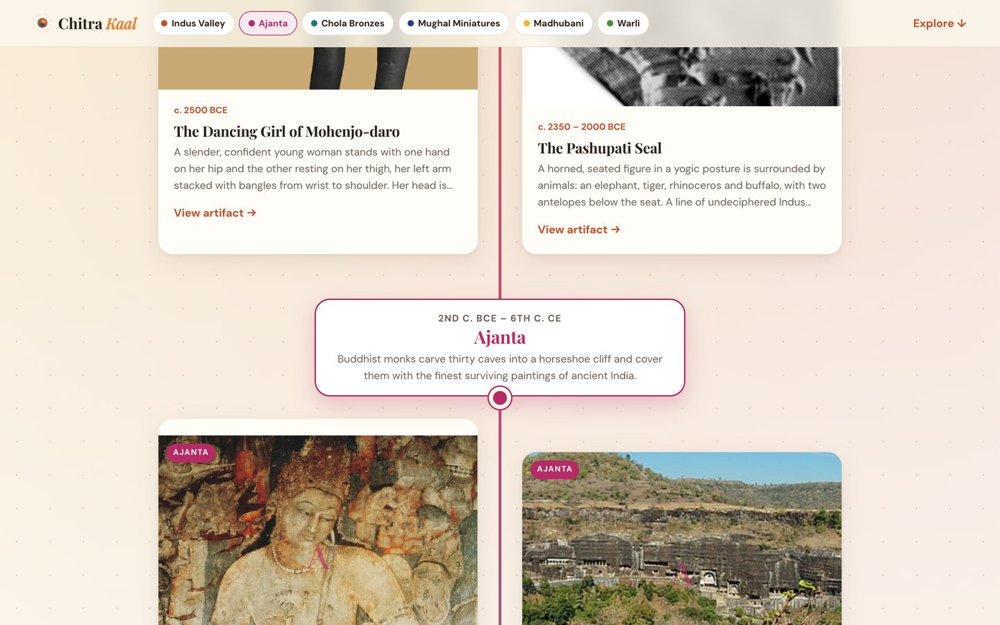
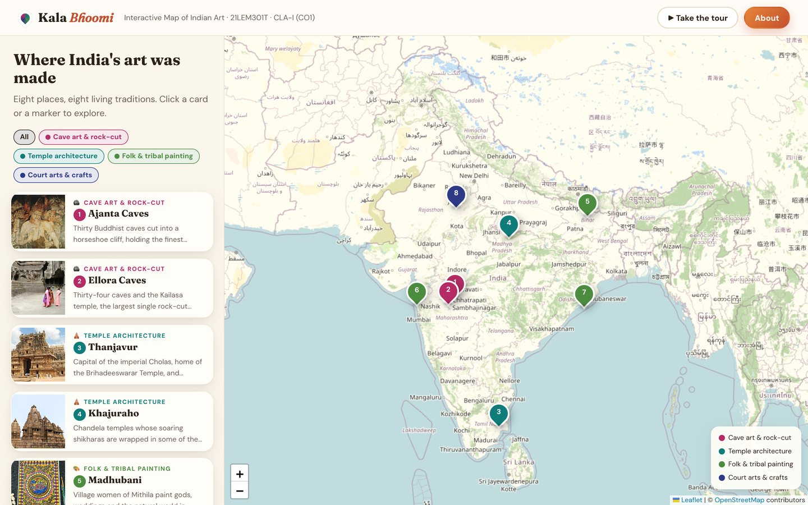
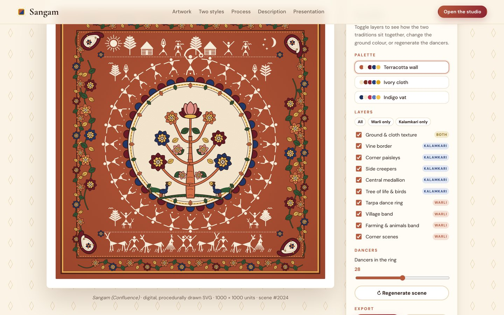
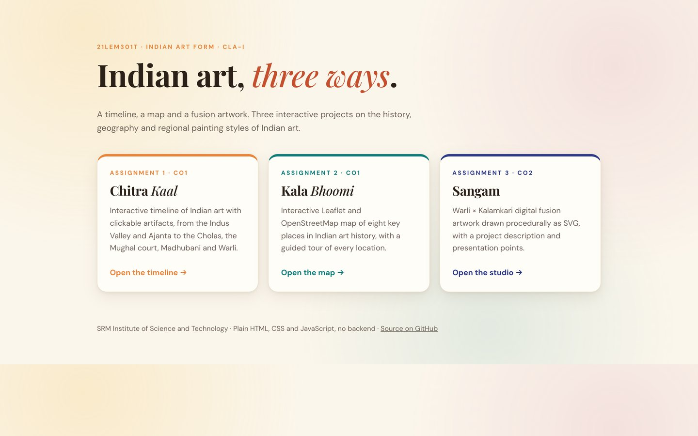

# Indian Art Form · CLA-I Projects

**21LEM301T Indian Art Form · CLA-I · SRM Institute of Science and Technology**

Three interactive projects on Indian art, in one repository.

**Live site:** https://zanyanbu.github.io/indian-art-form/

| Chitra Kaal · timeline | Kala Bhoomi · map |
|---|---|
| [](https://zanyanbu.github.io/indian-art-form/timeline/) | [](https://zanyanbu.github.io/indian-art-form/map/) |
| **Sangam · fusion artwork** | **Landing page** |
| [](https://zanyanbu.github.io/indian-art-form/fusion/) | [](https://zanyanbu.github.io/indian-art-form/) |

| Folder | Project | Assignment | Live |
|---|---|---|---|
| [`timeline/`](timeline/) | **Chitra Kaal** · interactive timeline of Indian art with clickable artifacts (Indus, Ajanta, Chola, Mughal, Madhubani, Warli) | 1 · CO1 | [Open](https://zanyanbu.github.io/indian-art-form/timeline/) |
| [`map/`](map/) | **Kala Bhoomi** · interactive Leaflet + OpenStreetMap map of key places in Indian art history | 2 · CO1 | [Open](https://zanyanbu.github.io/indian-art-form/map/) |
| [`fusion/`](fusion/) | **Sangam** · Warli × Kalamkari digital fusion artwork with project description and presentation points | 3 · CO2 | [Open](https://zanyanbu.github.io/indian-art-form/fusion/) |

Each folder has its own README with the details of that project.

## Run
No build or backend. Serve the repository root and open the landing page:
```bash
python3 -m http.server
```

## Tech
HTML, CSS and vanilla JavaScript. The map uses [Leaflet 1.9](https://leafletjs.com) and [OpenStreetMap](https://www.openstreetmap.org); photographs load from Wikimedia Commons under their respective free licences.

## History
This repository combines three earlier ones, with their commit history kept: `indian-art-timeline` → `timeline/`, `indian-art-map` → `map/`, `warli-kalamkari-fusion` → `fusion/`.
